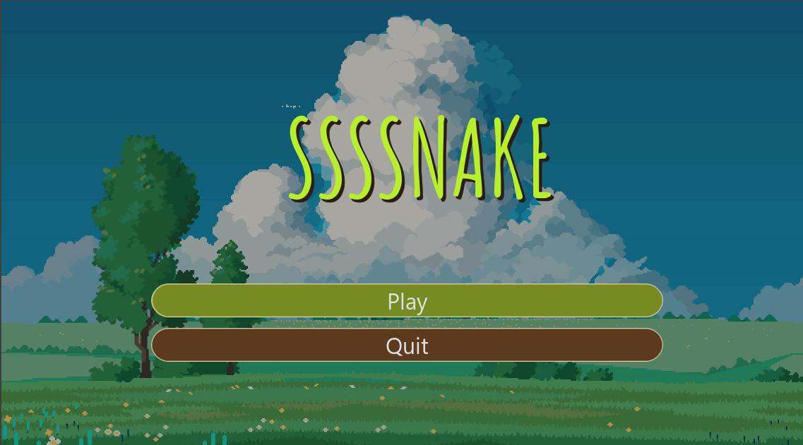
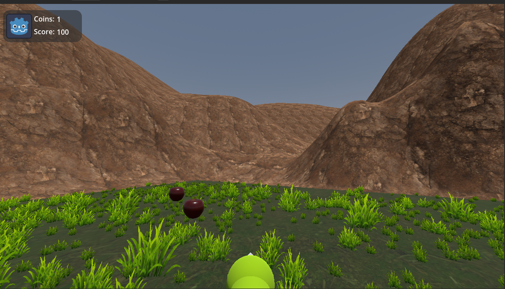
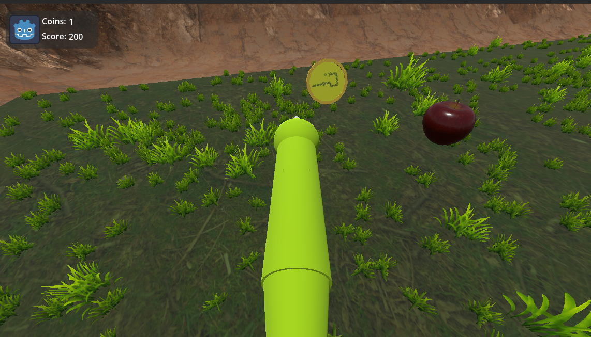
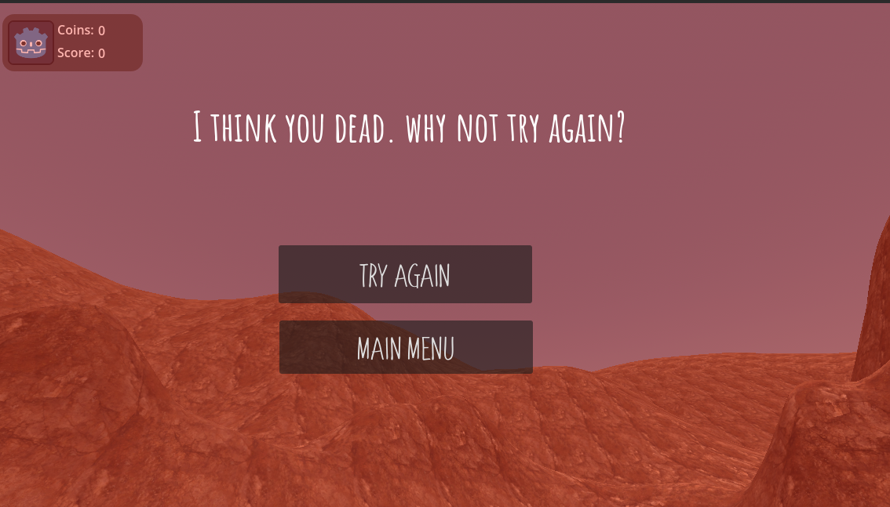

# 3D_Snake_Game
A snake game with a Nokia one, but it is 3D. 

## How this was made
It was made with Godot and GDScript.

## Why we made this

We wanted to make our first 3D game together as a group (but technically this is my (Kim Dokja's) first game and his (Remago's) third game).
I always wanted to make games with my friends as a team, so making this game, we had a blast. 

### Things we implemented

1. Creating the snake, movement, camera
2. Adding coins and food (as in apples)
3. Making score and coins,  
4. Deathscreen
5. Building the map/level 
6. Main menu 
7. Music and sounds
8. exporting the game

### screenshots 
main menu

game play 
 

death screen 

### Things we would love to implement 

1. making a use for coins and tracking score
2. adding styels and diffrent looks for the snake 
3. adding diffrent envirnoments 

### controlls 

just a mouse 

### how to play 

visit the itch.io link
(this one https://remago624.itch.io/3d_snake_game )

### Running from source 

know a lot about godot and want to change some stuff a bit then run your own snake 3d from the source 
you can do taht by clooning the repo (the link form the top of your browser ) or using this link (https://github.com/Remago624/3D_Snake_Game)

### System Requirements

* OS: Windows 10/11 64-bit
* CPU: A 4-core CPU is recommended
* RAM: 8 GB
* Storage: 350 MB
* GPU: A dedicated GPU is recommended